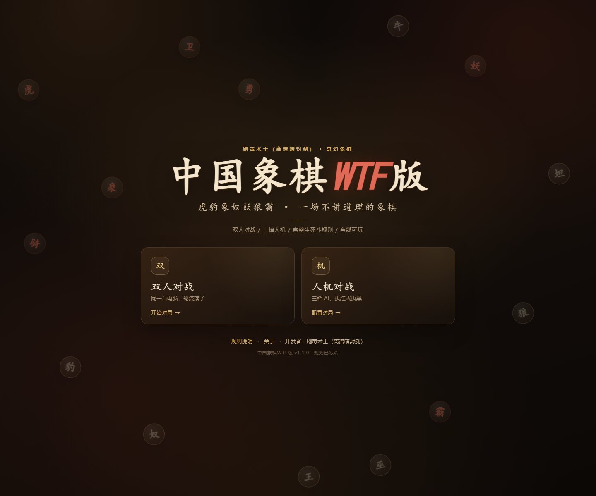
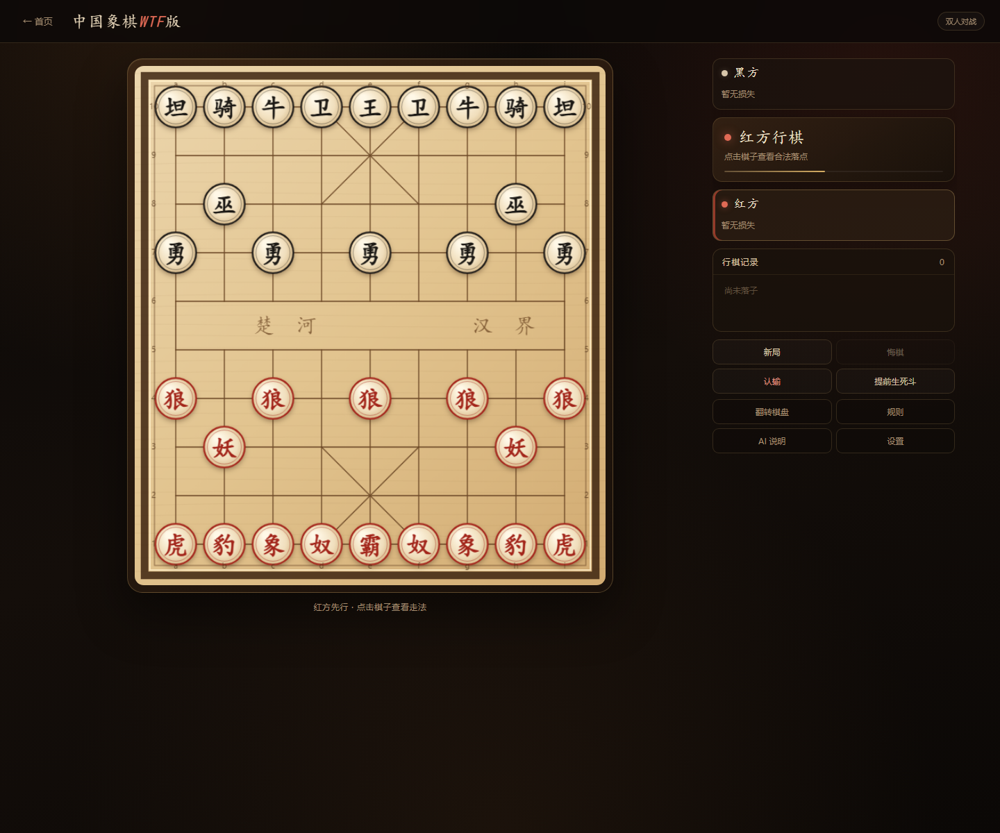
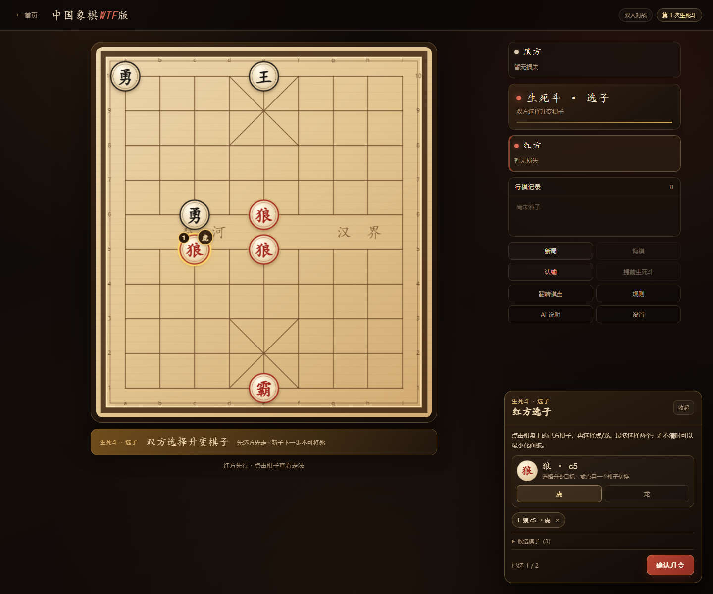
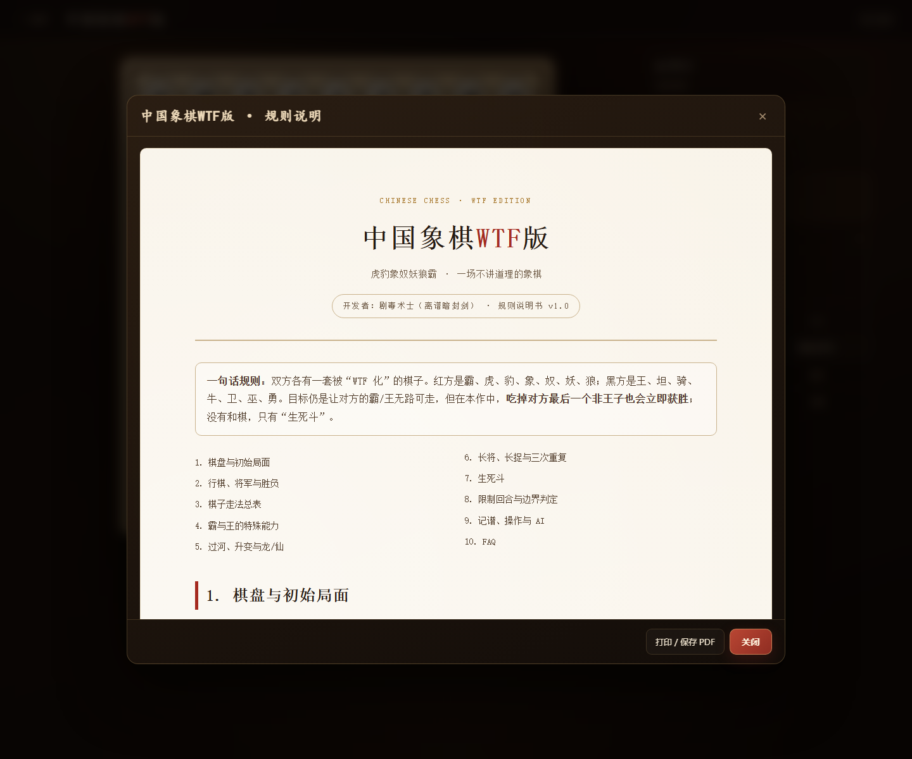
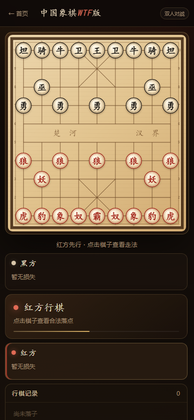

# 中国象棋WTF版

**开发者：剧毒术士（离谱暗封剑）**

[](LICENSE)

虎、豹、象、奴、妖、狼、霸；坦、骑、牛、卫、巫、勇、王。  
一个把象棋规则彻底改写、但仍然可以认真下完的奇幻变体。

## 预览











---

## 快速开始

### 方式一：单文件离线版（推荐）

如果你下载的是 GitHub Releases 中的离线包，直接双击 `启动游戏.bat`。  
如果你是从源码克隆仓库，先执行 `npm ci && npm run package`（PDF 步骤需要 Edge/Chrome），生成 `dist/game.html`。

双击：

```text
启动游戏.bat
```

它会用 **Microsoft Edge** 打开：

```text
dist\game.html
```

`dist\中国象棋WTF版.html` 是同一份游戏，也可以直接双击。  
这个 HTML 已内联全部 JS/CSS 和 AI Worker，**不需要联网、不需要安装、不需要服务器**。  
如果浏览器不允许本地 Worker，游戏会自动降级到主线程 AI，仍可正常对战。

> 如果你的系统默认 HTML 打开方式不是 Edge/Chrome，直接双击 HTML 可能没有反应。请使用 `启动游戏.bat`，它会显式调用 Edge；Edge 不存在时才回退到系统默认浏览器。

### 方式二：本地服务器版

如果单文件版在你的浏览器里遇到限制，双击：

```text
启动游戏-本地服务.bat
```

然后访问 `http://127.0.0.1:8000/`。

---

## 功能

- **双人对战**：同一台电脑轮流落子。
- **人机对战**：执红/执黑，三档难度。
- **完整特殊规则**：霸吃奴、王换卫、虎/坦斜一步、无蹩腿豹/骑、可过河象/牛、隔两子妖/巫、五向狼/勇、豹/骑升龙/仙。
- **生死斗**：3 步倒计时、先选先走、限制回合、超级子全灭再触发。
- **单王判负**：全局生效；吃掉对方最后一个非王子立即获胜。
- **长将/长捉**：程序化判定，长将/长捉方判负；普通三次重复进入生死斗。
- **规则说明书**：游戏内可看，另有 PDF。
- **完全离线**：无后端、无外部字体/图片/网络请求。

---

## 操作

| 操作 | 说明 |
|---|---|
| 点击己方棋子 | 显示合法落点 |
| 点击落点 | 落子 |
| 新局 | 重开当前模式 |
| 悔棋 | 人机模式会退回到你的回合 |
| 认输 | 结束当前对局 |
| 提前生死斗 | 第一次生死斗前可用；双人需双方确认，人机 AI 会同意 |
| 翻转棋盘 | 切换视角 |
| 规则 | 打开规则说明书 |
| AI 说明 | 查看搜索/评估/难度说明 |
| 设置 | 音效、棋盘坐标 |

---

## 规则速览

- 红方先行；保留将军、应将、飞将、困毙。
- 没有和棋；单王判负全局生效。
- 初始没有兵/卒：红方是狼，黑方是勇。狼/勇过河前只向前一步；过河后获得前、左、右、斜前左、斜前右 5 个方向；名称不变。
- 豹/骑无蹩马腿；到达对方底线当步升变为龙/仙，永久保留。
- 象/牛斜 1–2 格、可过河、不升变。
- 虎/坦 = 车 + 斜一格。
- 奴/卫限九宫，直/斜 1–2 格；霸可吃任意奴，王可与任意卫换位（换后必须间隔一步，任意黑方着法均可）。
- 妖/巫不吃子时直线滑行；吃子时隔 1 或 2 个棋子。
- 生死斗：双方≤5 子/三次重复 → 3 个半回合倒计时 → 走 1 步的一方先选 → 双方各最多变 2 个非王棋子 → 先选方先走 → 红黑各一步内新子不可将死。
- 虎/坦/龙/仙全部被吃（含初始车）后，若已进入过生死斗，立即再触发。
- 长将/长捉采用简化判定；详见规则书。

完整规则、边界判定和 FAQ 见：

- 游戏内「规则」按钮；
- `中国象棋WTF版-规则说明书.pdf`；
- `src/rulebook/rulebook.html`。

---

## AI 说明

AI 使用：

- Negamax + Alpha-Beta 剪枝；
- 迭代加深；
- 静态搜索（吃子/将军）；
- 子力 + 位置 + 王安全 + 最后一个非王子 + 升变潜力 + 生死斗变身价值评估；
- 着法排序：吃子、升变、将军、历史启发；
- Web Worker 运行，不阻塞界面。

| 难度 | 搜索 | 时间 |
|---|---|---|
| 简单 | 深度 2 | 约 0.35 秒 |
| 普通 | 深度 4 | 约 1 秒 |
| 困难 | 迭代加深至深度 6 | 约 2.4 秒 |

AI 会在同分着法中随机选择；不是大师水平，但不会走出非法着法。

---

## 模拟与平衡实验

项目内置无界面自对弈工具，可以批量跑局、输出 JSONL 和平衡/多样性报告：

```powershell
npm run simulate -- --games 200 --red search:2:60 --black search:2:60 --seed 20261025 --out sim/results/pilot-001 --report reports/pilot-001.md
```

或直接复现 200 局 pilot：

```powershell
npm run simulate:pilot
```

输出：

```text
sim/results/<run>/config.json
sim/results/<run>/games.jsonl
sim/results/<run>/summary.json
reports/<run>.md
```

当前首份报告：[reports/pilot-001.md](reports/pilot-001.md)。
`sim/results/` 不提交；报告可以提交到 `reports/`。

注意：AI 自对弈能发现平衡、多样性、节奏和规则漏洞，**不能替代人类试玩**。正式结论至少需要 2000+ 局、多档 agent 和 5–10 人试玩。

---

## 开源与许可

本项目使用 **[MIT License](LICENSE)**。

- 任何人都可以免费游玩、复制、修改、再分发；
- 允许商业使用和闭源分发；
- 必须保留版权和许可声明；
- 不提供任何担保。

选择 MIT 是为了让规则和实现尽可能自由地传播。需要说明的是：**MIT 不能从法律上阻止别人收费，也不能阻止别人闭源分发修改版**；它保证的是源码公开、任何人都有权使用和再实现。如果你希望强制衍生作品继续开源，应使用 AGPL-3.0 等 copyleft 许可证。

规则玩法本身通常不受版权保护；受保护的是本项目的代码、规则书文字、棋子/棋盘绘制、截图和文档。名称与标识不默认授予商标许可。

---

## 参与贡献

- 贡献指南：[CONTRIBUTING.md](CONTRIBUTING.md)
- 行为准则：[CODE_OF_CONDUCT.md](CODE_OF_CONDUCT.md)
- 安全政策：[SECURITY.md](SECURITY.md)
- 变更记录：[CHANGELOG.md](CHANGELOG.md)
- 发布到 GitHub / Pages / Release：[PUBLISHING.md](PUBLISHING.md)

规则已冻结；规则改动请先开 Issue 讨论，并同步测试和规则书。

---

## 开发

环境：Node.js 20+（推荐 24，见 `.nvmrc`），npm。

```powershell
npm ci
npm run dev
```

打开 `http://127.0.0.1:8000/`。

```powershell
npm run test       # Vitest 单元测试
npm run typecheck  # TypeScript 检查
npm run build      # 类型检查 + 单文件构建
npm run smoke      # UI 冒烟测试（需先运行 npm run dev）
npm run simulate   # 无界面批量自对弈
npm run package    # 构建 + 生成 PDF + 打包单文件
```

`npm run smoke` 和 PDF 生成需要本机有 Edge/Chrome；如果不在默认路径，设置 `EDGE_PATH`：

```powershell
$env:EDGE_PATH = "C:\path\to\msedge.exe"
```

`dist/` 是构建产物，不提交到仓库；在线版用 GitHub Pages 构建，离线版和 PDF 通过 GitHub Releases 分发。

构建后：

```powershell
Copy-Item dist\index.html dist\game.html
Copy-Item dist\index.html dist\中国象棋WTF版.html
```

单文件构建由 `vite-plugin-singlefile` 完成，AI Worker 使用 `?worker&inline` 内联。

---

## 目录

```text
src/
  game/       # 棋盘、走法、规则、生死斗、重复判定
  ai/         # 评估、搜索、选子、Worker、Client
  ui/         # Canvas 棋盘、页面、弹窗、音效
  rulebook/   # 规则说明书 HTML（游戏内 iframe + PDF 源）
  tests/      # Vitest 单元测试
public/       # favicon
scripts/      # 本地服务器、浏览器测试脚本
sim/          # 无界面自对弈工具与说明
reports/      # 可提交的平衡/多样性报告
release/      # Windows 分享包（不提交）
dist/         # 构建产物（不提交）
.github/      # CI、GitHub Pages、Issue/PR 模板
LICENSE       # MIT
```

---

## 规则实现说明

- 升变不能使尚未行棋的一方处于将军状态；若某个选择会这样，界面会拒绝并要求重选。
- 升变若使当前行棋方被将死，立即判对方获胜。
- 新子可以吃成单王、可以掩护旧子将死；限制回合只禁止新子作为将死最后一手。
- 双方同意提前生死斗只允许第一次；之后只能靠≤5 子/三次重复/超级子全灭。
- 长将/长捉为简化判定：同一局面第三次出现时，若一方循环内每步都将军（或每步都新威胁同一敌子），该方判负；否则进入生死斗。
- 为防止无限僵局，连续 120 个半回合无吃子、无狼/勇移动、无升变时，自动进入 3 步生死斗倒计时。

---

## 规则书 PDF

`中国象棋WTF版-规则说明书.pdf` 由 Edge 无头模式打印 `src/rulebook/rulebook.html` 生成。  
游戏内「规则」按钮可查看同一份说明书，并可打开新窗口打印/保存 PDF。

---

## 已知限制

- 长将/长捉采用简化判定，不实现棋协规则的全部例外。
- AI 的生死斗选子使用启发式评估，不进行完整的双方选子博弈搜索。
- 单文件版在极少数浏览器中可能无法创建内联 Worker，此时会自动使用主线程 AI。

---

## 非官方声明

本项目是非官方的中国象棋变体，与任何象棋协会、赛事组织或商业公司无关。  
“中国象棋WTF版”名称仅用于标识本项目；MIT License 不授予商标权。

---

## English Overview

**Chinese Chess WTF Edition** is an open-source, offline-capable Xiangqi variant by **剧毒术士（离谱暗封剑）**.

It features two-player local play, three AI difficulty levels, a custom “life-and-death duel” phase, a complete in-game rulebook, a printable PDF, and a single-file build that runs directly in modern browsers.

Licensed under the **MIT License**. See [LICENSE](LICENSE), [CONTRIBUTING.md](CONTRIBUTING.md), and [PUBLISHING.md](PUBLISHING.md).

---

**中国象棋WTF版 · 开发者：剧毒术士（离谱暗封剑） · MIT License · 规则已冻结**
